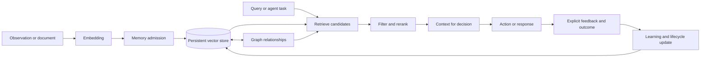

# Local AI Vector Memory Engine

> A polyglot AI memory platform with a Rust retrieval core and Python-first application workflows.

**Local AI Vector Memory Engine** is a learning-focused AI systems project inspired by the ideas explored in RuVector. It combines a Rust-native memory and retrieval core with Python embeddings, RAG orchestration, model integration, and evaluation workflows.

The project is currently in the **research and architecture phase**. The capabilities described below are the target design, not claims that every feature has already been implemented.

## What we are building

The engine will combine:

| Capability | Purpose |
| :--- | :--- |
| **Semantic memory** | Store embeddings and retrieve relevant memories by meaning |
| **Persistent vector search** | Preserve searchable knowledge across process restarts |
| **Metadata filtering** | Restrict retrieval by source, type, time, user, or namespace |
| **Graph context** | Represent relationships between memories, entities, and concepts |
| **Feedback learning** | Improve ranking from explicit corrections and outcomes |
| **Memory lifecycle** | Admit, rank, update, decay, archive, and delete memories |
| **Shared memory** | Optionally support multiple agents or isolated namespaces |
| **Interactive observability** | Visualize storage, retrieval paths, graph links, and memory changes |

The goal is not to reproduce every component in a large AI ecosystem. The goal is to understand the important mechanisms deeply and build a coherent system that can be extended without becoming impossible to reason about.

## The central loop



Every important decision should eventually be inspectable: what was stored, why it was retrieved, which relationships influenced the result, and how feedback changed future behavior.

## Design principles

- **Local first:** keep the core useful without requiring a hosted service.
- **Evidence over claims:** support conclusions with tests, measurements, and reproducible experiments.
- **Understandable components:** prefer clear boundaries over accidental complexity.
- **Explicit learning:** retrieval alone does not equal learning; adaptation must come from recorded feedback or outcomes.
- **Safe memory:** support provenance, namespaces, deletion, and isolation from the beginning.
- **Observable behavior:** expose enough internal information to explain retrieval and memory decisions.
- **Incremental scope:** start with a reliable core and add advanced algorithms only when their value is demonstrated.

## Planned architecture

```text
Applications, agents, CLI, and language integrations
                         │
                  Query and memory API
                         │
          ┌──────────────┴──────────────┐
          │                             │
   Vector retrieval              Memory and graph services
   exact / ANN / reranking       lifecycle / relationships
          │                             │
          └──────────────┬──────────────┘
                         │
       Persistent storage, indexes, provenance, namespaces
                         │
              Evaluation and visualization
```

The visualization layer is not a decorative mockup. It will be connected to real engine events and will help explain query paths, candidate selection, graph traversal, feedback, and memory evolution.

## Development roadmap

### Phase 1 — Understand and define

- Audit the relevant RuVector source code and tests.
- Separate foundational components from optional, experimental, and unrelated packages.
- Define the minimum target architecture and data model.

### Phase 2 — Build the retrieval core

- Implement vector records, collections, and metadata.
- Add exact search as a correctness baseline.
- Add persistence and restart/reopen tests.
- Measure recall, latency, and storage behavior.

### Phase 3 — Make memory useful

- Add memory admission and lifecycle policies.
- Add filtering, namespaces, provenance, and deletion.
- Add a first agent-memory workflow across multiple sessions.

### Phase 4 — Add structure and learning

- Introduce graph relationships where they improve retrieval.
- Record explicit feedback and outcomes.
- Compare baseline ranking against feedback-aware ranking.

### Phase 5 — Expose and visualize

- Build a clean CLI and application API.
- Add optional language bindings.
- Create an interactive explorer backed by real query traces and memory data.

### Phase 6 — Evaluate and refine

- Add reproducible datasets and benchmarks.
- Test correctness, isolation, failure recovery, and concurrency.
- Document what works, what does not, and what should remain out of scope.

## Current status

| Area | Status |
| :--- | :--- |
| Project direction | Defined |
| RuVector source audit | In progress |
| Target architecture | Draft |
| Core implementation | Not started |
| Interactive explorer | Planned |
| Benchmarks | Planned |

The first implementation will be deliberately smaller than RuVector. Features will be promoted into the core only when their behavior, value, and testing strategy are understood.

## Why this project exists

This is a hands-on AI engineering project for learning how modern AI memory systems work below the application layer:

- embeddings and similarity search
- indexing and persistence
- retrieval quality and reranking
- graph-assisted context
- feedback-driven adaptation
- agent memory design
- performance measurement and systems trade-offs

The final result should be more than a demo. It should be a documented, measurable, and explainable AI substrate that can support personal agents and future experiments.

## Non-goals for the first version

- Reimplementing all RuVector packages.
- Claiming production readiness before testing it.
- Adding advanced algorithms only because they sound impressive.
- Hiding retrieval behavior behind an unexplained black box.
- Running a large distributed service before the local core is reliable.

## License

The license and attribution model will be finalized before substantial code is published. Any reused code or design must retain its original license and attribution requirements.
