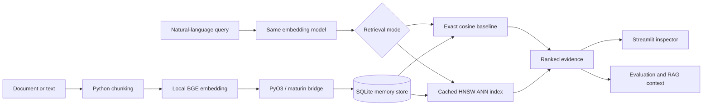

<div align="center">

<a href="https://prakyathmc.github.io/local-ai-vector-memory-engine/explorer/"></a>

# Local AI Vector Memory Engine

### A Python-first AI memory workflow with a Rust-native storage and retrieval core.

<p>
  <a href="https://prakyathmc.github.io/local-ai-vector-memory-engine/explorer/">Interactive Explorer</a>
  ·
  <a href="#quick-start">Quick start</a>
  ·
  <a href="#architecture">Architecture</a>
  ·
  <a href="#roadmap">Roadmap</a>
</p>


<br>

**Understandable AI infrastructure for local semantic memory, retrieval, and experimentation.**

</div>

<p align="center"><sub><a href="https://prakyathmc.github.io/local-ai-vector-memory-engine/explorer/">Launch the interactive Explorer</a> · <a href="assets/memory-engine-walkthrough.md">Read the animated walkthrough</a> · <a href="#quick-start">Run it locally</a></sub></p>

## What this is

Local AI Vector Memory Engine is a learning-focused project for understanding the important mechanisms behind persistent AI memory directly. It deliberately starts as a smaller, coherent system that can grow without becoming impossible to reason about:

```text
documents → chunks → local embeddings → SQLite memory records
                                      ↓
query → exact search or HNSW ANN → ranked evidence
                                      ↓
                         inspection, evaluation, and RAG context
```

The project intentionally separates AI experimentation in Python from performance-sensitive storage and retrieval in Rust.

## Current capabilities

| Capability | Current implementation |
| --- | --- |
| Persistent memory | SQLite-backed Rust store with restart-safe records |
| Embeddings | Local `BAAI/bge-small-en-v1.5`, 384 dimensions |
| Ingestion | Python document loading, deterministic word chunking, overlap, and re-ingestion |
| Exact retrieval | Rust cosine similarity baseline with deterministic ranking |
| ANN retrieval | Rust HNSW index through `hnsw_rs` |
| HNSW lifecycle | Per-namespace lazy cache with invalidation after writes |
| Filtering | Namespace, source, type, status, and creation-time filters on exact search |
| Provenance | Source, model, dimensions, metadata, and timestamps stored with each memory |
| Inspection | Streamlit dashboard, memory explorer, embedding projection, and HNSW Observatory |
| Evaluation | Labeled retrieval fixture plus exact-vs-HNSW comparison and synthetic benchmark |

Advanced graph relationships, feedback learning, multi-agent shared memory, and generation adapters are intentionally future work. They are not presented as implemented features.

## See it visually

<a href="https://prakyathmc.github.io/local-ai-vector-memory-engine/explorer/"></a>

<p align="center"><sub>Click the trailer to open the interactive Explorer.</sub></p>

### Interactive Explorer

Open the [Local AI Memory Explorer](https://prakyathmc.github.io/local-ai-vector-memory-engine/explorer/) to explore the memory flow, exact search path, HNSW path, index layers, and ranked results in the browser.

The Explorer is a lightweight static visualization of the current architecture. The live local database inspector is the Streamlit application described below.

### Local Streamlit inspector

The local UI lets you ingest text, inspect chunks and embeddings, compare exact retrieval with HNSW, and observe the first-query index-build cost versus warm-query latency.

```cmd
cd /d D:\REA
.venv\Scripts\streamlit.exe run python\app.py
```

Then open `http://localhost:8501` and select **HNSW observatory**.

## Architecture



### Why both exact and HNSW?

Exact search checks every eligible vector. It is easy to understand and acts as the correctness oracle.

HNSW builds a navigable graph over vectors. It usually costs more during index construction, but can reduce warm-query work as the collection grows. We compare HNSW against exact search instead of silently assuming it is correct.

On the current synthetic 1,000-vector benchmark:

| Measurement | Result |
| --- | ---: |
| Exact p50 query latency | 13.454 ms |
| HNSW build + first query | 2414.230 ms |
| HNSW warm p50 query latency | 1.670 ms |
| HNSW recall of exact top-10 | 100% |
| SQLite file size | 1.996 MB |
| Raw vector payload | 1.465 MB |
| HNSW process RSS increase | 8.820 MB |

These are workload-specific learning measurements, not production performance claims.

## Animated walkthrough

<details>
<summary><strong>Open the full eight-chapter walkthrough</strong></summary>

The walkthrough explains the current system in plain language: chunking, embeddings, persistence, exact retrieval, HNSW, evidence, evaluation, and the next frontier.

→ [Open the animated walkthrough](assets/memory-engine-walkthrough.md)

</details>

<details>
<summary><strong>What the current Explorer does</strong></summary>

- Shows a query moving through embedding, index selection, ranking, and evidence.
- Switches between exact search and HNSW ANN modes.
- Filters the conceptual memory graph by namespace.
- Highlights returned memories and displays ranked scores.
- Explains that the graph is a visual projection, not the 384-dimensional retrieval space.

</details>

<details>
<summary><strong>What is implemented versus planned</strong></summary>

**Implemented:** SQLite persistence, local BGE embeddings, chunk ingestion, exact cosine retrieval, HNSW retrieval, filters, lifecycle controls, evaluation, benchmarks, and Streamlit inspection.

**Planned:** feedback learning, graph relationships, richer query traces, and a RAG context API.

</details>

## Quick start

### 1. Create the environment

```cmd
cd /d D:\REA
py -3.14 -m venv .venv
.venv\Scripts\activate
.venv\Scripts\python.exe -m pip install -r requirements.txt
```

### 2. Download the local embedding model

```cmd
.venv\Scripts\python.exe python\download_embedding_model.py
```

The model is stored locally under `models/` and is ignored by Git.

### 3. Build the Python extension

```cmd
cd /d D:\REA\python\local_ai_memory
..\..\.venv\Scripts\maturin.exe develop --release
cd /d D:\REA
```

### 4. Run the tests

```cmd
.venv\Scripts\python.exe -m pytest python\tests -q
set PYO3_PYTHON=D:\REA\.venv\Scripts\python.exe
cargo test --workspace
```

### 5. Run evaluation and benchmarking

```cmd
.venv\Scripts\python.exe python\evaluate_retrieval.py
.venv\Scripts\python.exe python\benchmark_retrieval.py
```

## Project layout

```text
crates/
├── memory-core/        Domain types and validation
├── memory-store/       SQLite schema, persistence, and lifecycle
├── memory-retrieval/   Cosine baseline and HNSW ANN index
└── memory-python/      PyO3 bindings exposed as local_ai_memory

python/
├── app.py              Streamlit observability UI
├── embedding.py        Local and deterministic embedding providers
├── ingest_documents.py Chunking and ingestion workflow
├── evaluate_retrieval.py
├── benchmark_retrieval.py
└── tests/

explorer/
└── index.html           GitHub Pages interactive architecture explorer

assets/
├── memory-engine-header.svg      Animated README header
├── memory-engine-trailer.svg     Clickable README trailer
└── memory-engine-walkthrough.md  Chapter-based visual explanation
```

## Design principles

- **Learn before abstracting:** every major mechanism has a simple baseline first.
- **Exact search is the oracle:** ANN results are measured against exact retrieval.
- **Python for AI workflows:** models, chunking, evaluation, and future RAG orchestration stay easy to experiment with.
- **Rust for the substrate:** validated records, transactions, vector math, and indexes live behind a stable native boundary.
- **SQLite is the source of truth:** HNSW is a derived, rebuildable acceleration structure.
- **Inspectability over magic:** IDs, scores, metadata, provenance, filters, and lifecycle state are visible.
- **Verified claims only:** planned features are clearly separated from implemented behavior.

## Roadmap

- [x] Persistent memory registry and model-card validation
- [x] Local embedding and deterministic chunk ingestion
- [x] Exact cosine retrieval with filters
- [x] HNSW ANN retrieval and cache invalidation
- [x] Exact-vs-HNSW evaluation and benchmark tooling
- [x] Streamlit HNSW Observatory
- [x] Interactive architecture/index Explorer
- [ ] Feedback recording and ranking experiments
- [ ] RAG context package API
- [ ] Query traces backed by real engine events
- [ ] Optional graph relationships and graph-aware retrieval
- [ ] Version 1 hardening and release checklist

## Learning goal

This project is a hands-on study of AI engineering below the chatbot layer: embeddings, vector storage, ANN indexing, retrieval quality, lifecycle controls, provenance, and the systems trade-offs behind local agent memory.

## License

MIT. See [LICENSE](LICENSE).
