# Local AI Vector Memory Engine walkthrough

This visual walkthrough explains the current engine from ingestion to retrieval. The animation is conceptual: the live local behavior is available through the Streamlit HNSW Observatory.

## Chapters

<strong>01 · Chunking — turn documents into memory units</strong>

Documents are split into deterministic overlapping chunks. Each chunk keeps its source and boundaries so retrieval can point back to evidence.

<strong>02 · Embeddings — turn meaning into coordinates</strong>

The local BGE model converts each chunk and query into a 384-dimensional vector. The database enforces one embedding model and dimension configuration.

<strong>03 · Persistence — SQLite is the source of truth</strong>

Rust validates memory records and stores content, vectors, provenance, namespaces, metadata, and lifecycle state in SQLite.

<strong>04 · Exact retrieval — the correctness oracle</strong>

Cosine similarity checks every eligible active memory. This path is simple, deterministic, filterable, and used as the comparison baseline.

<strong>05 · HNSW — navigate instead of scanning everything</strong>

HNSW stores a derived graph of nearby vectors. It costs more to build, but warm queries can be much faster. The index is rebuilt from SQLite after restart or writes.

<strong>06 · Evidence — make every result inspectable</strong>

Results expose IDs, scores, source paths, model provenance, dimensions, metadata, and namespace information.

<strong>07 · Evaluation — measure before claiming</strong>

Exact and HNSW results are compared on labeled queries. Benchmarks report latency, recall, SQLite size, vector payload, and process-memory impact.

<strong>08 · Next frontier — feedback and graph context</strong>

Feedback learning, graph relationships, and richer RAG context are planned extensions. They will be added only when their data model and evaluation strategy are clear.

